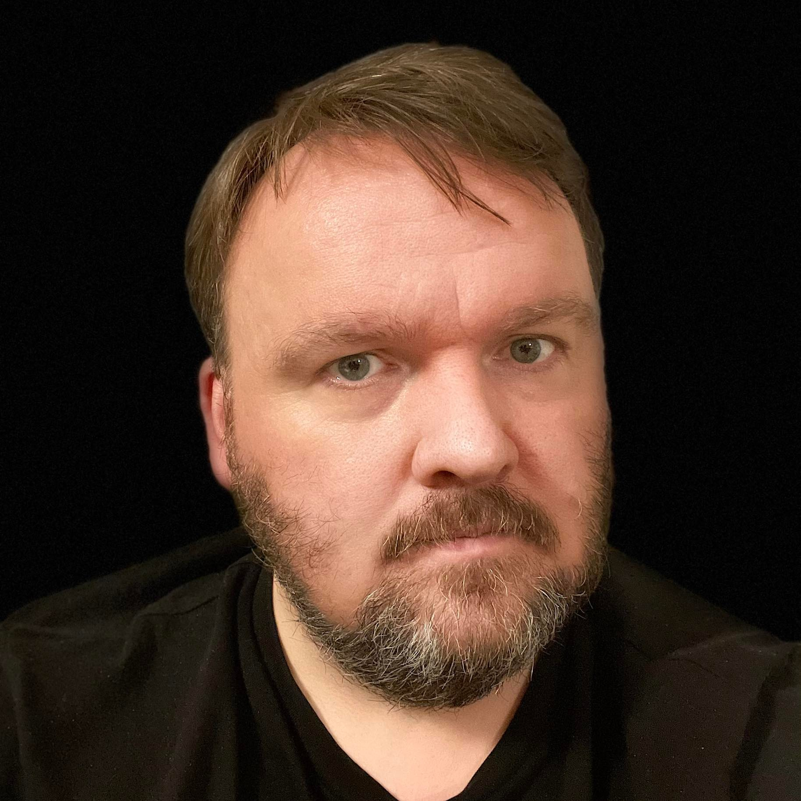

<!-- Home page: portrait floated left, the bio wrapping round and under it, as
     on the Calepin site (calepin-site/index.typ). The .hero* classes are in
     assets/styles/styles.css. The bio is the first-person version of /bio.md at
     the repository root; change them together. -->

::::: hero
::: hero-portrait

:::

::: hero-bio
I am Associate Professor of Social Science at the Centre for the Study of Democracy, SWPS University, Warsaw. A political scientist and sociologist, I study populism, illiberalism, democratic backsliding and electoral behaviour in Central and Eastern Europe, especially Poland.

My most recent book, [*Good Change: The Rise and Fall of Poland's Illiberal Revolution*](pages/good-change.qmd) (Stanford University Press, 2025), written with Stanley Bill, explains how the Law and Justice government won and lost power, and what its eight years reveal about the illiberal challenge to liberal democracy. I am also a co-author of *External Voting* (Palgrave Macmillan, 2023), on the electoral participation of Central European emigrants. My articles have appeared in *Comparative Political Studies*, *Perspectives on Politics*, the *Journal of Democracy*, *Party Politics* and *East European Politics*, and my 2008 article "The Thin Ideology of Populism" is widely cited.

My current research examines how firmly citizens hold to liberal democracy when partisan polarisation runs high, the rise of postliberal attitudes, and the difficulties of rebuilding democracy after illiberal rule. I led the National Science Centre project "Partisan Bias or a Climate of Indifference?" (2021–2026) and was a co-investigator on AUTHLIB, a Horizon Europe project on neo-authoritarianism in Europe. I now lead the work package on the economic dimensions of enlargement in CitiSense, a Horizon Europe project on EU enlargement (2026–2029).

I hold a PhD in Government from the University of Essex and a habilitation in sociology from the Polish Academy of Sciences. I previously worked at the Institute for Public Affairs in Bratislava, Cardinal Stefan Wyszyński University in Warsaw and the University of Sussex, where I was a Marie Curie Fellow. I am deputy editor of the *Polish Sociological Review* and a regular contributor to *Kultura Liberalna*.
:::
:::::
