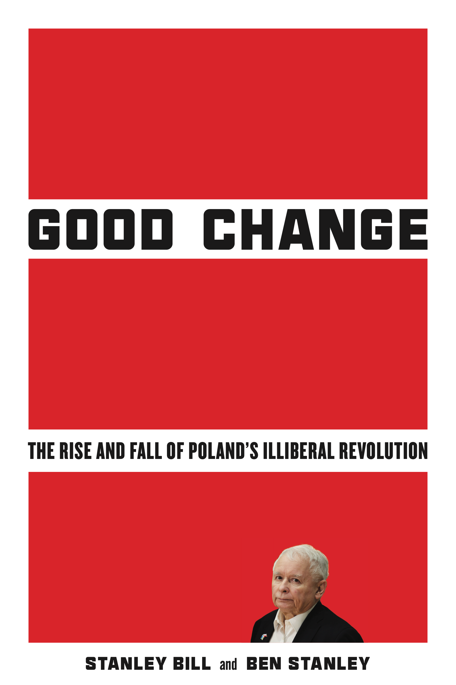

::::: columns
::: {.column width="50%"}
*The Rise and Fall of Poland's Illiberal Revolution*\

Stanley Bill and Ben Stanley

Stanford University Press

Few countries serve as a more useful case study for understanding the global tension between liberal and illiberal conceptions of democracy than Poland. Under the populist Law and Justice (PiS)-led government, a large part of the Polish electorate welcomed the party's "Good Change"—as it described its program—despite accusations of democratic backsliding. PiS offered voters neglected by previous governments a combination of economic redistributionism and cultural traditionalism, supplemented with narratives of bolstering Poland's national prestige and sovereignty. Yet, after eight years of success, it was defeated in the October 2023 elections by a "pro-democratic" coalition. The history of PiS shows both the strengths and weaknesses of democratic illiberalism as a challenge to liberal democracy.\
\
Bill and Stanley analyze the course and causes of the party's successes and failures. The authors deftly outline PiS's assault on democratic institutions, its paradigm-changing redistributive programs, cultural backlash agenda, politics of history, and the reasons for its fall from power. Poland's democracy has proven resilient to the specter of autocratization, but its future development under a new government raises fresh questions. This essential book considers what the rise and fall of Poland's illiberal government reveals about the future of liberal democracy and its ongoing transformations in the 21st century.

**Stanley Bill** is Professor of Polish Studies, University of Cambridge. He is the Chair of the Cambridge Committee for Russian and East European Studies (CamCREES). **Ben Stanley** is Associate Professor at the Centre for the Study of Democracy, SWPS University of Social Sciences and Humanities.\
\
September 2025\
344 pages \| 6x9\
14 figures\
Paper\
\$35.00 (£27.99) SDT 9781503643680\
Cloth\
\$140.00 (£110.00) SDT 9781503634565\
eBook 9781503643697\
International Affairs
:::

::: {.column width="50%"}
{fig-align="left"}

**Reviews**

"This nuanced and data-driven analysis shows how support for the right was undermined by widespread opposition to conservative policies on abortion and other issues, along with Law and Justice's failure to deliver low-inflation growth, benefits for farmers, and smooth relations with the EU. … This is a must-read for all who follow central European politics."

—Andrew Moravcsik, *Foreign Affairs*

"By refusing to write off the dominant Polish political force of the past two decades as an aberration, Stanley Bill and Ben Stanley's *Good Change* helps us to discern how illiberals in countries other than the US have responded to genuine demands from within the liberal mould, changing liberalism in the process."

—Piotr H. Kosicki, *Times Literary Supplement*

"A book as topic-specific and detailed about a particular case study as this one is, and as far-reaching and theoretically complex, is usually a rare event."

—Ray Taras, *Slavic Review*
:::
:::::
